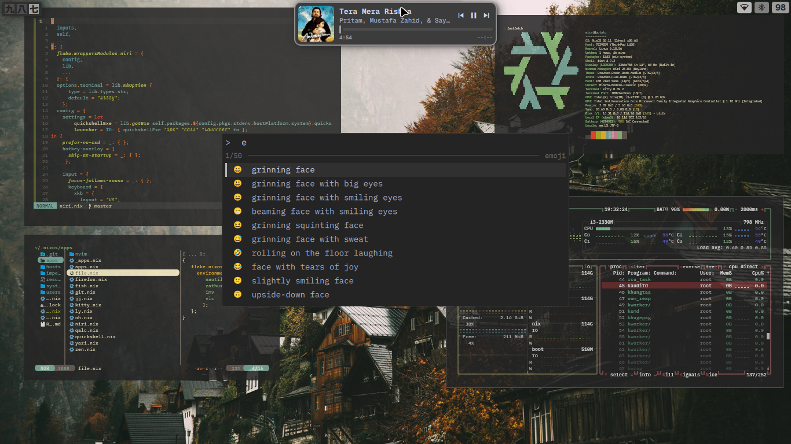

# Minimal Impermanence NixOS Config

> A simple, dendritic, ephemeral root(impermanence) NixOS configuration built with flakes.

---


## Contents

- [Overview](#overview)
- [Keybindings](#keybindings)
- [Installation](#installation)
- [Architecture](#architecture)
- [Impermanence](#impermanence)
- [Hosts & Users](#hosts--users)
- [File Structure](#file-structure)
- [Theming](#theming)
- [QuickShell](#quickshell)
- [Holy Thanks](#holy-thanks)

---

## Overview

This configuration is made to be **as minimal as possible**—focusing on reproducibility, and zero unnecessary bloat. It provides a wrapped, modular desktop environment without overhead. It also includes **optional** impermanence (root wiped on every boot, btrfs based). It is off by default for the `potato` host and can be switched on with one uncomment - it works only on `btrfs` filesystem (for now)- [Read](#impermanence)

---

## Keybindings

Necessary window manager shortcuts: discover lot more :)

| Keybinding | Action |
| :--- | :--- |
| <kbd>Mod</kbd> + <kbd>Space</kbd> | Application Launcher |
| <kbd>Mod</kbd> + <kbd>Enter</kbd> | Terminal (`kitty`) |
| <kbd>Mod</kbd> + <kbd>Q</kbd> | Close Window |
| <kbd>Mod</kbd> + <kbd>F</kbd> | Toggle Fullscreen |
| <kbd>Mod</kbd> + <kbd>Shift</kbd> + <kbd>F</kbd> | Toggle Floating / Popup Window |
| <kbd>Mod</kbd> + <kbd>Tab</kbd> | overview desktop |

---
> [!IMP-NOTE]
> Regarding launcher option keybinds refer to the [quickshell-config](https://codeberg.org/khnmrz/quickshell)

## Installation
>[!IMPORTANT]
>Impermanence is **optional**. If your disk is not btrfs, or you just don't want it, skip step 1 and the config works on any normal filesystem.
>Repo clone is required. Remote build is not fully prepared yet. But remote launch app via `nix run "git+https://codeberg.org/khnmrz/nixos.git#Appname"` is supported for the wrapped apps.
### 1. Choose: with or without impermanence
- **With impermanence** (btrfs): refer to [Impermanence](#impermanence)
  ```nix
    		]
  		++ (with self.nixosModules; [ 
	   # impermanence  <------ uncomment this.

  ```
- **Without impermanence**(nay filesystem): skip step 1.

### 2. Clone the repository
```bash
git clone https://codeberg.org/khnmrz/nixos.git ~/<path to your choice>/< eg. ~/nixos/ >
cd ~/<cloned path>
rm -rf .git
```

### 3. Build & Apply
Default host is `potato` (yes my device is the same:)), provided driver packages are for old intel cpu. Configure `system/drivers/potao_dri.nix` as per your system.
>[!IMPORTANT]
>Default `locale`, `bootloader-grub` are en_US(`hosts/potato/_legacy/_locale.nix`), BIOS system respectively. If using UEFI device, must change them accordingly.  
```bash
# Test the configuration (dry-run or build without switching)
nixos-rebuild build --impure --flake .#potato  #if changed hostname then #yourhostname

# Switch configuration
sudo nixos-rebuild switch --impure --flake .#<hostname>

# Update flake inputs
nix flake update
```
`--impure` is must because hardware-configuration vary by devices unless you paste yours in `hosts/potato/hardware-configuration.nix` here, else it will failed to build.

---

## Architecture

The `flake.nix` dynamic loader automatically discovers and imports configuration files:

- **Auto-Import**: All files inside the config directory are automatically imported into the flake outputs.
- **Ignored / Excluded**:
  - `flake.nix`
  - `flake.lock`
  - Any file prefixed with an underscore (`_`)

To temporarily disable a module or keep private templates unparsed, simply prefix the filename with an underscore (e.g., `_module.nix`).

### filetree 
```text
will include later (its unnecessary anyway for a dendritic setup )
```

---

## Impermanence

You dont want it, skip it. To use it your disk must be in `btrfs` having `/persist`, `/`, `/nix` as subvol in a your main partition. Root (`/`) is wiped on every boot. Only what is declared as persistent survives. This ephemeral root setup used btrfs wipe instead of tmpfs due to some personal reasons (im having RAM crisis,lol).

> [!NOTE]
> Optional. To turn it off, stop bothering this section (see [Installation](#installation)). Everything below applies only when it is enabled.

### How it works

`fs.nix` mounts three btrfs subvolumes from one partition (label `persist`):

```text
persist partition (btrfs)
├── root     -> /         deleted and recreated empty on every boot
├── persist  -> /persist  kept (user data and selected system state)
└── nix      -> /nix      kept (the Nix store)
```

- A systemd initrd service (`rollback-root`, in `fs.nix`) deletes the `root` subvolume and creates a fresh one before root is mounted.
- `preservation.nix` ([nix-community/preservation](https://github.com/nix-community/preservation)) bind-mounts the chosen directories and files from `/persist` back into place.
- `persist` and `nix` are bros of `root`, not childs, so the wipe never touches them.

### Requirements

| Needed | Details |
| :--- | :--- |
| Partition | One btrfs partition labeled `persist` with subvolumes `root`, `persist`, `nix` |
| /boot | Separate FAT32 partition labeled `BOOT` (ESP on UEFI, /boot on BIOS) |
| Swap | Optional, partition labeled `swap` (set `my.fs.swapDevice = null;` for none) |
| Initrd | `boot.initrd.systemd.enable = true` (already set in `preservation.nix`) |
| Password | Must be declared (`hashedPasswordFile` or `hashedPassword`), because `passwd` changes are wiped |

### Why btrfs instead of tmpfs

| | tmpfs root | btrfs wipe-on-boot |
| :--- | :--- | :--- |
| Root lives in | RAM | Disk |
| Size limit | Fixed, eats RAM | Free disk space |
| Big temp files (builds, caches) | Can fill RAM and cause OOM | Fine, uses disk |
| Setup | Simplest | Needs rollback script and subvolumes |

tmpfs is lot simpler if you have plenty of RAM. (im having RAM crisis, bruh!)

### Disk setup (from a live ISO)
> [!WARNING]
> This process required live usb iso and will nuke your drive. So only try if moderate or above, [Here](https://btrfs.readthedocs.io/en/latest/btrfs-subvolume.html).
 make those partition and subvol acoording to the  and clone the repo to the clone the repo into `/mnt/persist/home/<user>/.nixos`, then install:
```bash
nixos-install --root /mnt --no-root-passwd --impure --flake /mnt/persist/home/<user>/.nixos#<hostname>
```

### Using it

**Persist something new.** If something vanishes after a reboot, declare it in `preservation.nix`:
- System path: add it to `preserveAt."/persist".directories` or `files` (for example `"/var/lib/NetworManager"` if you use iwd).
- Home path: add it to `my.persist.homeDirectories` or `homeFiles`, for example `".config"` or `{ directory = ".ssh"; mode = "0700"; }`.

Then rebuid and reboot.

**Test that it works.**
```bash
touch /testfile && sudo reboot
ls /testfile            # should not exist
ls /nix/store | wc -l   # should still be thousands
```

**Troubleshooting.**: 
No idea dude, mine worked so you are on your own.

## Hosts & Users
Default host: `potato`, username: `dihh`, password: `dihh`.
Change the username or password in `nodes/users/primaryuser.nix` if you wish.

> [!WARNING]
> Without impermanence you can change the password with `passwd` after the first rebuild. **With impermanence, `passwd` is wiped on reboot**, so change it in `nodes/users/primaryuser.nix` instead (use a hash from `mkpasswd -m yescrypt`, or a `hashedPasswordFile` on `/persist`).

### Hosts
- **`potato`**:  main host have all features. 
- **`<host-2>`**:   make one if you want multiple machines config.

### Users
- **`dihh`**:  main user. 

---

<<<<<<< HEAD
=======
## Keybindings

Necessary window manager shortcuts: discover lot more :)

| Keybinding | Action |
| :--- | :--- |
| <kbd>Mod</kbd> + <kbd>Space</kbd> | Application Launcher |
| <kbd>Mod</kbd> + <kbd>Enter</kbd> | Terminal (`kitty`) |
| <kbd>Mod</kbd> + <kbd>Q</kbd> | Close Window |
| <kbd>Mod</kbd> + <kbd>F</kbd> | Toggle Fullscreen |
| <kbd>Mod</kbd> + <kbd>Shift</kbd> + <kbd>F</kbd> | Toggle Floating / Popup Window |
| <kbd>Mod</kbd> + <kbd>Tab</kbd> | overview desktop |

---
> [!Imp-Note]
> Regarding launcher option keybinds refer to the [quickshell-config](https://codeberg.org/khnmrz/quickshell)
>>>>>>> be090196b1e93028ec0261a0bef2838c4c13bc1a

## Theming

Colorscheme is taken from [Vimjoyer's](https://github.com/vimjoyer/nixconf/blob/main/theme.nix). this muted color palette maybe the best among i have used so far.
Font is `IBM Plex Sans` and cursor is `Bibata Modern classic`. More theming option will include later. (im bad with colors, lol)

---

## QuickShell

All the viral Qs rices are mid, overanimated, funky or in berif, type of shii. (imo)
So I forked [A Dumb Human's](https://git.voidarc.co.uk/voidarc/quickshell)(voidarc's) shell, which was made only for hyprland, to make it work for niri.
A cool multifuntion launcher is included.
for Detailed info read [Quickshell-config](https://codeberg.org/khnmrz/quickshell)

## Holy Thanks

Special thanks to:
- [Vimjoyer](https://github.com/vimjoyer/nixconf) — for the foundational dendritic pattern and wrapped programmes, specially neovim.
- [A Dumb Human](https://git.voidarc.co.uk/voidarc/quickshell) — for quickshell.
